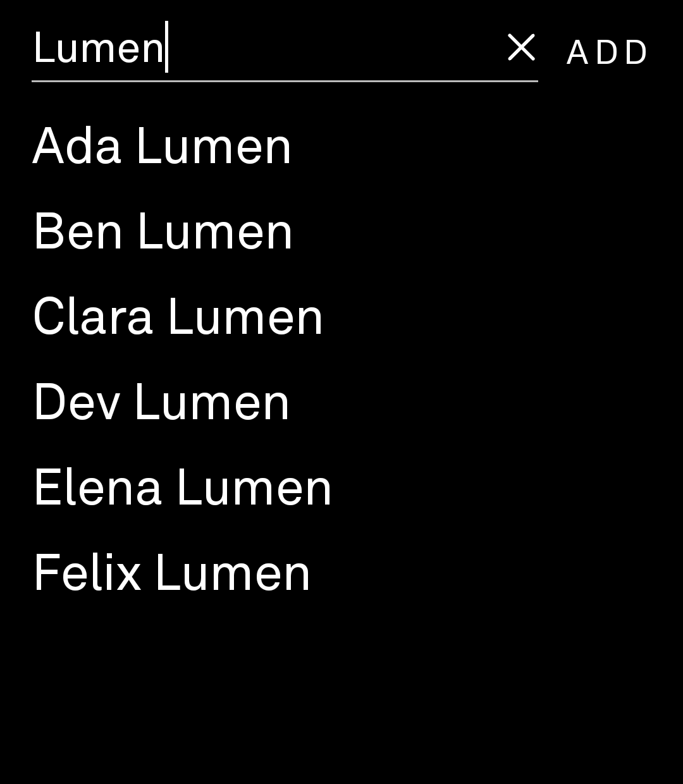
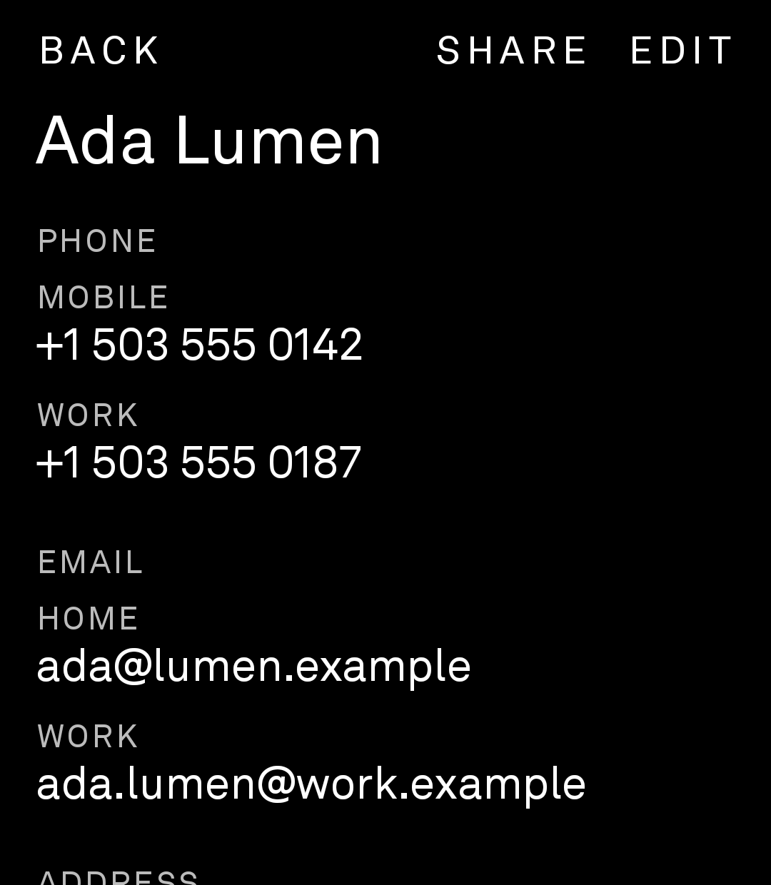
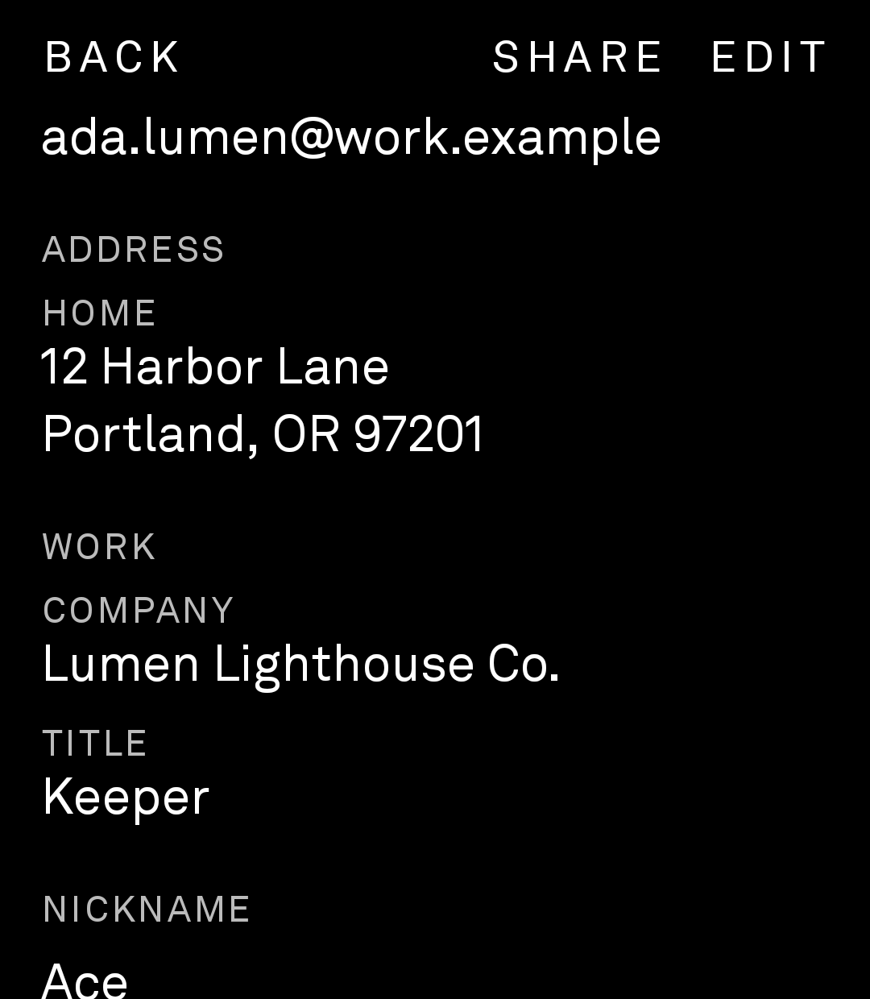
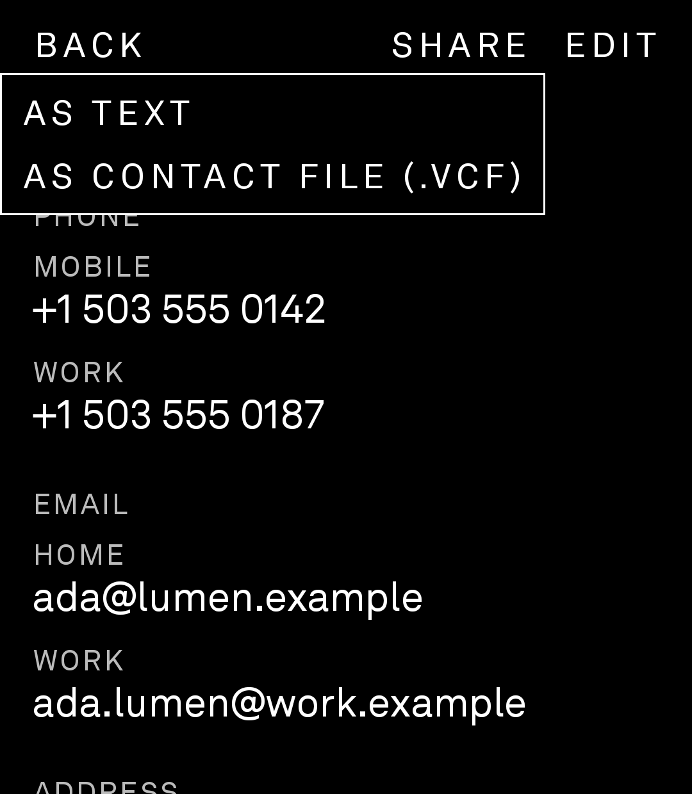
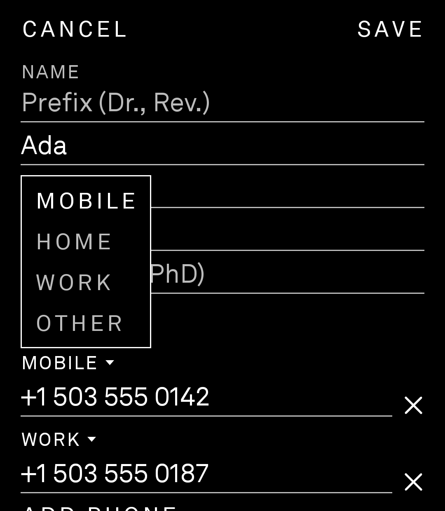

# Rolodex

A full contacts app for the **Light Phone III**, styled to match LightOS.

The contacts screen built into LightOS shows one number per contact. Rolodex shows and edits everything saved on a contact, keeps it in sync with your contacts server, and handles the contact requests other apps send to Android's contacts app.

<p>
  
  
  
  
  
</p>

*Screenshots from a Light Phone III, using made-up demo contacts.*

**[Download the latest APK](https://github.com/jmsbrain/Rolodex/releases/latest)**, then follow [Install on the Light Phone III](#install-on-the-light-phone-iii).

## Features

### Browse
- Every contact in one searchable list. Tap the **X** to clear the search.
- Each contact card shows, in this order: full name breakdown (when there's a prefix, suffix or phonetic name), phone numbers, emails, addresses, work (company, title, department), nicknames, related people, messaging handles, SIP addresses, websites, dates (birthday, anniversary…), and notes.
- **Tap a phone number** to open the LightOS phone screen with it filled in. From there, call or text as usual.
- **Tap an email** to copy it. **Tap an address** to open maps. **Tap a website** to open it.
- **Long-press anything** to copy it. If no app on the phone can handle an action, the value is copied instead.

### Edit
- **EDIT** on a contact card opens the editor. **ADD** next to the search box creates a new contact.
- Every field above can be edited, except phonetic names. Each type label (MOBILE, HOME, SIGNAL…) is a dropdown. **X** removes a line, and **ADD PHONE**, **ADD EMAIL** and so on add one.
- Dates are typed as `MM/DD/YYYY`, or `MM/DD` when there's no year.
- Nothing is written until **SAVE**. CANCEL, or the back button, asks before throwing away changes.
- **DELETE CONTACT**, at the bottom of the editor, asks you to confirm. Deleting can't be undone.

### Share
- **SHARE** on a contact card sends the contact through SMS, Signal, WhatsApp or any other app on the share menu, in one of two forms:
  - **As text:** the name followed by "Mobile: …", "Email: …" and so on. Notes are left out.
  - **As contact file (.vcf):** Android's own vCard export, with every field, notes included.

### Works with other apps
Rolodex answers the same requests as Android's stock Contacts app:

| When another app wants to… | Rolodex shows… |
|---|---|
| add a new contact ("Add to contacts") | the editor, filled in with what the app sent |
| add details to an existing or new contact | the contact list with a **NEW** button, then the editor |
| edit a contact | the editor for that contact |
| pick a contact, phone number, email or address | a searchable list. Your choice goes back to the app |
| show a contact (including quick contact cards) | that contact's card |
| open a `.vcf` file | the editor for one contact, or a list with **IMPORT ALL** for several |

The editor and picker return you to the app that asked.

## Syncing

Rolodex edits the phone's own contacts store, so whatever syncs your contacts carries the changes. For example, DAVx5 syncs them to a CardDAV server.

- **New contacts** are saved to the account that holds most of your contacts among those that sync back to a server. This is your main address book, not a phone-only contact.
- **Merged contacts** often have copies from other apps such as WhatsApp and Signal/Molly. Rolodex writes new details to the main address book's copy, so the changes sync.
- Duplicate copies of the same number or email are edited and removed together.

## Making it the default contacts app

Android has no "default contacts app" setting. When an app asks to show, add or pick a contact, Android either asks which app to use, or uses the only one installed.

- **Simple:** when Android asks, choose **Rolodex → Always**. Android remembers this separately for each kind of request.
- **Thorough:** disable the stock Contacts app so Rolodex is the only choice. Your contacts aren't affected:
  ```bash
  adb shell pm disable-user --user 0 com.android.contacts
  ```
  To undo it:
  ```bash
  adb shell pm enable com.android.contacts
  ```
  While the stock app is disabled, its screens for SIM contact import, merging duplicates and account settings aren't available.

**The contacts button in the LightOS dialer** opens LightOS's built-in contacts screen and doesn't ask Android. No app can take over that button. Open Rolodex from the home screen instead.

## LightOS notes

- Rolodex asks LightOS to open its phone screen the same way Light SDK tools do. LightOS only answers sideloaded apps when the phone is set to allow **"Any tools"**. Otherwise Rolodex sends a normal dial request.
- Text sizes follow LightOS's design scale. The contact list is 30% larger than standard (`LIST_TEXT_SCALE`), and everything else is 20% larger (`TEXT_SCALE`). Both are set in `LightStyle.kt`.
- It uses the phone's Akkurat font when the font is present.

## Why it isn't a Light SDK tool

The Light SDK doesn't let tools read or write contacts: `READ_CONTACTS` isn't on its permission allow-list, and `contentResolver` is blocked. Rolodex is a plain Android app instead. Light doesn't sign it, so it has to be **sideloaded**.

## Privacy

Rolodex needs **Contacts** permission to read and edit contacts. It has **no internet permission**. Contact details only leave the phone when you share a contact, or through your own sync app.

## Build

You need **Android Studio**, or JDK 17+ and the Android SDK.

- **Android Studio:** **File → Open** this folder, wait for the Gradle sync, then **Build → Build App Bundle(s) / APK(s) → Build APK(s)**.
- **Terminal:** run `gradlew.bat assembleDebug`. If `JAVA_HOME` isn't set, point it at Android Studio's bundled JDK first:
  ```powershell
  $env:JAVA_HOME = "C:\Program Files\Android\Android Studio\jbr"
  ```

The APK is written to `app\build\outputs\apk\debug\app-debug.apk`.

## Install on the Light Phone III

1. Download `Rolodex-<version>.apk` from the [latest release](https://github.com/jmsbrain/Rolodex/releases/latest), or [build it yourself](#build).
2. On the phone, turn on Developer options and USB debugging, then connect it by USB.
3. Install, or update over an existing install:
   ```bash
   adb install -r Rolodex-1.5.1.apk
   ```
   Use the file name you downloaded. For your own build, it's `app\build\outputs\apk\debug\app-debug.apk`.
3. Open Rolodex and allow Contacts access. If no prompt appears, grant it from the computer:
   ```bash
   adb shell pm grant com.jms.fullcontacts android.permission.READ_CONTACTS
   ```
   ```bash
   adb shell pm grant com.jms.fullcontacts android.permission.WRITE_CONTACTS
   ```
4. If it doesn't show up in LightOS, launch it with:
   ```bash
   adb shell am start -n com.jms.fullcontacts/.MainActivity
   ```

## License

Rolodex is open source under the [MIT License](LICENSE). You're free to use, change and share it, as long as you keep the copyright notice.

<!--
Version history: kept in this file but hidden on the GitHub page.

## Versions

Versions follow **MAJOR.MINOR.PATCH**: MINOR goes up for new features, and PATCH for fixes and tweaks. Each release is tagged `vX.Y.Z`. Downloadable APKs are on the [Releases page](https://github.com/jmsbrain/Rolodex/releases), from 1.5.1 on.

| Version | Changes |
|---|---|
| 1.5.1 | Dropdowns open above their label when there's no room below; tidier name hints |
| 1.5.0 | Answers other apps (add, edit, pick, quick contact, .vcf import); SHARE as text or .vcf |
| 1.4.3 | Tighter gap under search; email above address |
| 1.4.2 | Larger list text; dropdowns for field types |
| 1.4.1 | Contact card uses the editor's section order |
| 1.4.0 | Every field editable; new contacts save to the synced account |
| 1.3.0 | Edit, add and delete contacts |
| 1.2.0 | Contacts viewer |
-->

## Project layout

```
app/src/main/kotlin/com/jms/fullcontacts/
  RolodexActivity.kt     shared base: permissions, dial / map / copy / share actions
  MainActivity.kt        the app: list, contact cards, editor; opens contacts other apps link to
  RequestActivity.kt     answers other apps: add, edit, pick, .vcf import
  App.kt                 screens: permission, contact list, contact card, menus
  ContactEditor.kt       the editor screen and its dropdowns
  ContactsRepository.kt  reads contacts for the list, cards, picker and sharing
  ContactWriter.kt       loads contacts for editing and writes changes back
  Prefill.kt             details sent by other apps, applied to the editor
  VCard.kt               reads .vcf files (vCard 2.1, 3.0, 4.0)
  LightStyle.kt          LightOS-like font, colors and text sizes
  LightOsBridge.kt       asks LightOS to open its own phone screen
```
